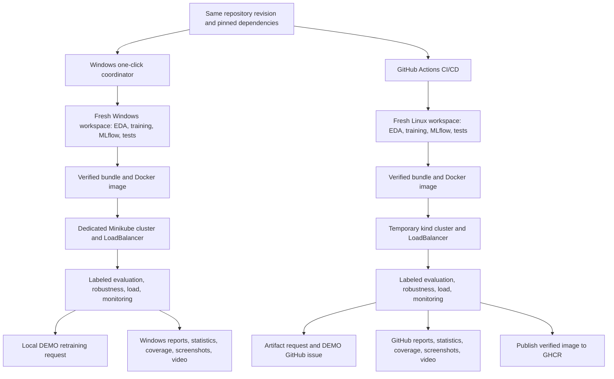

# Execution and evidence architecture

Each track trains its own model; model identity and hashes follow it into its own
deployment. Neither track consumes the other one's model or reports. Evaluation
uses known labels; synthetic corruption is visibly marked DEMO. Requests require
human review and do not automatically retrain/promote a model. The live operational
API dashboard and the labeled acceptance monitoring report have distinct scopes.
